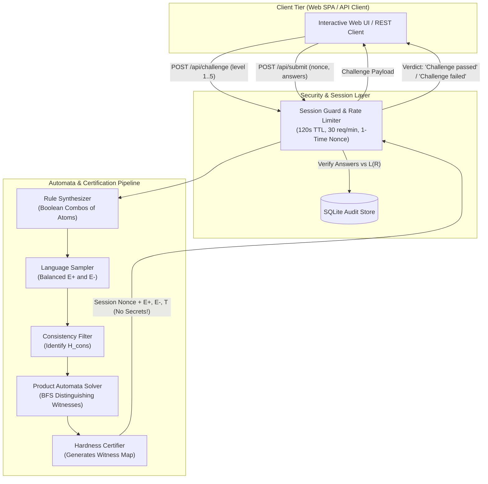

<<<<<<< HEAD
# Veridyn
=======
<div align="center">

# VeriDyn

**Certified Inductive Challenges Built from Finite Automata**

*A College Theory of Computation Project in Formal Language Induction & Adversarial Verification*

[](https://www.python.org/)
[](https://fastapi.tiangolo.com/)
[](tests/)
[](#theoretical-foundations)
[](#zero-knowledge-security-model)
[](LICENSE)

[Overview](#overview) •
[Scope Statement](#mandatory-scope-statement) •
[Theoretical Foundations](#theoretical-foundations) •
[System Architecture](#system-architecture) •
[Difficulty Levels](#difficulty-levels) •
[Quickstart](#quickstart--installation) •
[API Reference](#rest-api-reference) •
[Experiments](#empirical-evaluation-suite) •
[Security & Threat Model](#security--threat-model)

---

</div>

## Overview

**VeriDyn** (`veridyn`) is a collegiate Theory of Computation (TOC) research and software engineering project that explores **formal language induction** through certified adversarial challenges. 

In a VeriDyn challenge, a respondent observes small sets of labelled positive ($E^+$) and negative ($E^-$) example strings generated by a **hidden regular rule** $R$ over a ternary alphabet $\Sigma = \{C, T, S\}$. The respondent's goal is to inductively deduce the underlying regular language and correctly classify an unlabelled set of test strings $T$.

Unlike conventional captchas or heuristic inductive puzzles, VeriDyn provides a **mathematical hardness certificate**:
- The challenge strings are algorithmically synthesized via automata-theoretic algorithms (Thompson's $\varepsilon$-NFA construction, powerset determinization, Myhill-Nerode table-filling minimization, cross-product Boolean closure, and BFS distinguishing witness search).
- For every candidate rule $h$ in a predefined hypothesis library $\mathcal{H}$ that is consistent with the shown examples $(E^+, E^-)$, there is **at least one witness test string** in $T$ on which $h$ and the true rule $R$ disagree.
- Consequently, **no automated solver or heuristic strategy confined to the hypothesis class $\mathcal{H}$ can pass the challenge.**

---

## Mandatory Scope Statement

> VeriDyn certifies that no guessing strategy in a stated hypothesis class passes the challenge. It does NOT verify that a respondent is human. Learners, programs and language models outside that class are not covered.

---

## Key Features

- **100% Pure Python Automata Engine**: Built entirely from first principles without third-party automata libraries. Implements full regular expression parsing, $\varepsilon$-NFA compilation, DFA determinization with complete sink states, minimal DFA canonicalization, and product automata.
- **Formally Certified Hardness**: Every challenge is generated alongside a mathematical certificate verifying that $\forall h \in \mathcal{H}_{\text{cons}}, \exists t \in T$ such that $h(t) \neq R(t)$.
- **Zero-Knowledge Server Architecture**: The hidden rule, its regular expression, its state transition tables, and the certification matrix never leave the server. Only unlabelled test sequences and example strings are exposed.
- **Strict, Non-Anthropomorphic Verdicts**: In strict alignment with its threat model, user-facing outcomes are strictly `"Challenge passed"` or `"Challenge failed"`. The platform never claims to detect "humans" or "bots".
- **Dynamic Cyberpunk Web Interface**: Modern, accessible single-page application (SPA) featuring visual tile sequences, interactive classification controls, real-time countdown timers, and progressive difficulty selection.
- **Rigorous Differential & Empirical Testing**: Fully differential-tested against Python's standard `re` oracle across all strings up to length 8 over $\Sigma = \{C, T, S\}$ (over 9,800 strings per rule), backed by a 7-part empirical experiment suite.

---

## Theoretical Foundations

Every core module in VeriDyn maps directly to core concepts from formal language theory and theoretical computer science:

| Component | Source File | Theory of Computation Concepts |
|:---|:---|:---|
| **Regex Parser & AST** | [`veridyn.core.regex_parser`](veridyn/core/regex_parser.py) | Chomsky Type 3 Grammar, Kleene Algebra, AST Desugaring (`+`, `?`, `{m,n}`) into Primitive Union, Concatenation, and Kleene Star. |
| **Thompson $\varepsilon$-NFA** | [`veridyn.core.nfa`](veridyn/core/nfa.py) | Inductive compilation of regex AST to Non-deterministic Finite Automata with $\varepsilon$-transitions; $\varepsilon$-closure computation. |
| **Subset Construction** | [`veridyn.core.dfa`](veridyn/core/dfa.py) | Rabin-Scott Powerset Construction converting NFA to complete Deterministic Finite Automata with explicit sink/dead states. |
| **State Minimization** | [`veridyn.core.minimize`](veridyn/core/minimize.py) | Myhill-Nerode Equivalence Relations; Table-Filling / Partition Refinement algorithm to construct the unique canonical minimal DFA. |
| **Boolean Closure** | [`veridyn.core.boolean_ops`](veridyn/core/boolean_ops.py) | Closure of regular languages under union ($\cup$), intersection ($\cap$), complement ($\neg$), set difference ($\setminus$), and symmetric difference ($\oplus$) via Cross-Product Automata. |
| **Distinguishing Witnesses** | [`veridyn.core.distinguish`](veridyn/core/distinguish.py) | Shortest distinguishing string extraction between non-equivalent DFAs via Breadth-First Search (BFS) on cross-product difference automata. |
| **Automata Analysis** | [`veridyn.core.analyze`](veridyn/core/analyze.py) | Reachability & live-state decomposition, language emptiness/infiniteness detection, dynamic programming word counts, uniform string sampling. |
| **Hypothesis Library ($\mathcal{H}$)** | [`veridyn.challenge.hypotheses`](veridyn/challenge/hypotheses.py) | Candidate regular language spaces (32 canonical minimal DFAs covering prefix, suffix, substring, avoidance, modulo count, parity, and length). |
| **Challenge Synthesis** | [`veridyn.challenge.generator`](veridyn/challenge/generator.py) | Balanced positive/negative example sampling ($2 \le |w| \le 6$) and adversarial test string selection ($|t| \le 8$). |
| **Formal Certification** | [`veridyn.challenge.certify`](veridyn/challenge/certify.py) | Witness assignment mapping $\operatorname{cert}: \mathcal{H}_{\text{cons}} \to T$ proving separation between all consistent hypotheses and ground truth. |

---

## Mathematical Specification

### Formal Definitions

- **Alphabet ($\Sigma$)**: Fixed ternary alphabet $\Sigma = \{C, T, S\}$.
- **Language ($L$)**: Regular subset $L(R) \subseteq \Sigma^*$ recognized by a complete, minimal DFA $M = (Q, \Sigma, \delta, q_0, F)$.
- **Hypothesis Class ($\mathcal{H}$)**: A fixed library of $|\mathcal{H}| = 32$ minimal DFAs representing atomic linguistic patterns:
  - Prefix constraints: starts with $X \in \Sigma$
  - Suffix constraints: ends with $X \in \Sigma$
  - Substring constraints: contains $X$, contains $XX$, avoids $XX$
  - Parity & modular counts: count of $X$ even/odd, count of $X \equiv 0 \pmod 3$
  - Length constraints: length even/odd, length $\le k$, length $\ge k$ ($k \in \{2, 3, 4\}$)
- **Hidden Target Rule ($R$)**: A Boolean combination of at most 2 atomic rules from $\mathcal{H}$ such that:
  $$\forall h \in \mathcal{H}, \quad L(R) \neq L(h)$$
- **Challenge ($C$)**: A tuple $C = (E^+, E^-, T)$ where:
  - $E^+ \subset L(R)$ with $|E^+| = 3$ and lengths $2 \le |w| \le 6$.
  - $E^- \subset (\Sigma^* \setminus L(R))$ with $|E^-| = 3$ and lengths $2 \le |w| \le 6$.
  - $T = (t_1, \dots, t_k)$ with $k = 6$ balanced test strings (3 valid, 3 invalid with respect to $L(R)$) and lengths $|t_i| \le 8$.
- **Consistent Hypotheses ($\mathcal{H}_{\text{cons}}$)**:
  $$\mathcal{H}_{\text{cons}} = \{ h \in \mathcal{H} \mid E^+ \subseteq L(h) \land E^- \cap L(h) = \emptyset \}$$
- **Certification Condition**:
  $$\forall h \in \mathcal{H}_{\text{cons}}, \quad \exists t \in T \quad \text{such that} \quad \mathbb{I}_{L(h)}(t) \neq \mathbb{I}_{L(R)}(t)$$
- **Random Guessing Baseline**: A coin-flipping respondent guessing randomly across $k = 6$ balanced test strings passes with probability:
  $$P(\text{pass by chance}) = 2^{-k} = 2^{-6} = \frac{1}{64} \approx 0.0156 \quad (1.56\%)$$

---

## System Architecture

The following diagram illustrates the zero-knowledge synthesis, certification, and verification flow:



---

## Difficulty Levels

VeriDyn scales challenge complexity across 5 structured difficulty levels based on the Boolean combination of atomic language properties and upper bounds on minimal DFA state count:

| Level | Identifier | Atoms | Composition Operator | Max Minimal States | Examples ($N_{ex}$) | Tests ($k$) | Description |
|:---:|:---|:---:|:---:|:---:|:---:|:---:|:---|
| **1** | **Novice** | 1 | Atomic rule outside $\mathcal{H}$ | $\le 6$ | 6 (3 pos, 3 neg) | 6 (3 pos, 3 neg) | Single atomic regular rule outside $\mathcal{H}$ (e.g. 2-symbol prefix/suffix, mod 3 count). |
| **2** | **Elementary** | 2 | Conjunction (`AND`) | $\le 8$ | 6 (3 pos, 3 neg) | 6 (3 pos, 3 neg) | Intersection of two distinct atomic properties ($h_1 \cap h_2$). |
| **3** | **Intermediate** | 2 | Difference (`AND NOT`) | $\le 10$ | 6 (3 pos, 3 neg) | 6 (3 pos, 3 neg) | Set difference between two atomic properties ($h_1 \setminus h_2$). |
| **4** | **Advanced** | 2 | Disjunction (`OR`) | $\le 12$ | 6 (3 pos, 3 neg) | 6 (3 pos, 3 neg) | Union of two distinct atomic properties ($h_1 \cup h_2$). |
| **5** | **Expert** | 2 | Symmetric Difference (`XOR`) | $\le 20$ | 6 (3 pos, 3 neg) | 6 (3 pos, 3 neg) | Parity/modular combinations ($h_1 \oplus h_2$), requiring subtle inductive reasoning. |

---

## Quickstart & Installation

### Prerequisites

- **Python**: Version 3.11 or newer
- **Operating System**: Linux, macOS, or Windows
- **Git**

### 1. Clone the Repository

```bash
git clone https://github.com/your-username/veridyn.git
cd veridyn
```

### 2. Create and Activate a Virtual Environment

**Linux / macOS:**
```bash
python3 -m venv .venv
source .venv/bin/activate
```

**Windows (PowerShell):**
```powershell
python -m venv .venv
.\.venv\Scripts\Activate.ps1
```

### 3. Install Dependencies

Install VeriDyn in editable mode with development and testing dependencies:

```bash
pip install -e ".[dev]"
```

*Note: Core automata modules use zero external dependencies. The only runtime dependencies are `fastapi`, `uvicorn`, and `pydantic` for serving the API.*

---

## Running the Application

### Start the Web Server

Launch the FastAPI backend and static web server using Uvicorn:

```bash
uvicorn veridyn.server.app:app --host 127.0.0.1 --port 8000 --reload
```

Once started, open your web browser and navigate to:

👉 **[http://127.0.0.1:8000](http://127.0.0.1:8000)**

### Interactive Web Interface

The web interface provides an intuitive environment for human solvers:
- **Difficulty Selector**: Choose between Levels 1 through 5.
- **Example Sequences**: Visual accepted ($E^+$ in emerald) and rejected ($E^-$ in rose) strings.
- **Visual Tile Renderer**: Each string is rendered both as plain text and as colored sequence tiles (`C`, `T`, `S`).
- **Interactive Test Grid**: Toggle candidate test strings between **Valid** and **Invalid**.
- **Live Nonce Countdown**: Real-time timer tracking the 120-second validity window.
- **Zero-Anthropomorphism Feedback**: Clean verdict modal showing score and official outcome.

---

## REST API Reference

The server exposes a minimal zero-knowledge REST API for headless solvers and automated benchmarks.

### 1. Generate Challenge

```http
POST /api/challenge
Content-Type: application/json
```

**Request Body:**
```json
{
  "level": 2,
  "session_id": null
}
```

**Response (`200 OK`):**
```json
{
  "session_id": "8fbc982a-431f-4e0d-b8aa-89c02d184711",
  "nonce": "k9xL2pQ8vM4wN7yR1sT3uV6w",
  "level": 2,
  "examples": [
    {"string": "CST", "label": "valid"},
    {"string": "TCSS", "label": "valid"},
    {"string": "SC", "label": "valid"},
    {"string": "TTT", "label": "invalid"},
    {"string": "CC", "label": "invalid"},
    {"string": "SST", "label": "invalid"}
  ],
  "tests": [
    {"id": "t1", "string": "CSTC"},
    {"id": "t2", "string": "TTCS"},
    {"id": "t3", "string": "SCC"},
    {"id": "t4", "string": "TC"},
    {"id": "t5", "string": "SSSS"},
    {"id": "t6", "string": "CTST"}
  ],
  "expires_in": 120,
  "attempts_left": 3,
  "note": "VeriDyn certifies that no guessing strategy in a stated hypothesis class passes the challenge. It does NOT verify that a respondent is human. Learners, programs and language models outside that class are not covered."
}
```

### 2. Submit Answers

```http
POST /api/submit
Content-Type: application/json
```

**Request Body:**
```json
{
  "nonce": "k9xL2pQ8vM4wN7yR1sT3uV6w",
  "answers": {
    "t1": "valid",
    "t2": "invalid",
    "t3": "valid",
    "t4": "invalid",
    "t5": "invalid",
    "t6": "valid"
  }
}
```

**Response (`200 OK`):**
```json
{
  "result": "Challenge passed",
  "correct_count": 6,
  "total_tests": 6,
  "attempts_left": 2,
  "message": "All test strings correctly classified under the hidden regular rule.",
  "note": "VeriDyn certifies that no guessing strategy in a stated hypothesis class passes the challenge. It does NOT verify that a respondent is human. Learners, programs and language models outside that class are not covered."
}
```

---

## Testing & Quality Assurance

VeriDyn maintains a strict zero-regression testing standard.

### Run Unit & Integration Tests

Execute the full test suite with `pytest`:

```bash
pytest
```

### Differential Testing Oracle

To guarantee mathematical correctness of custom automata algorithms, every construction phase is differential-tested against Python's built-in `re` engine across exhaustive subsets:

```bash
# Run property-based differential tests
pytest tests/core/test_regex_parser.py -v
pytest tests/core/test_boolean_ops.py -v
```

All operations ($\varepsilon$-NFA conversion, DFA powerset construction, minimization, and Boolean operations) are verified to accept the exact same subset of strings over all $\Sigma^{\le 8}$.

---

## Empirical Evaluation Suite

The repository includes a suite of 7 automated experiments located in `experiments/` to rigorously validate hardness, performance, and security boundaries.

### Run All Experiments

```bash
python experiments/run_all.py
```

All benchmark results and metrics are automatically compiled into CSV artifacts in `experiments/results/`:

| # | Benchmark Experiment | Module | Metrics & Output Artifact |
|:---:|:---|:---|:---|
| **1** | **Differential Correctness** | [`exp_correctness.py`](experiments/exp_correctness.py) | Tests equivalence across 9,841 strings against `re.fullmatch` &rarr; `correctness.csv` |
| **2** | **Automata Performance & Blow-Up** | [`exp_performance.py`](experiments/exp_performance.py) | Measures state explosion and transformation timings across operations &rarr; `performance.csv` |
| **3** | **$\mathcal{H}$-Guesser Certification** | [`exp_certification.py`](experiments/exp_certification.py) | Empirically proves 100% of certified challenges reject all consistent $h \in \mathcal{H}$ &rarr; `certification.csv` |
| **4** | **Coin-Flip Baseline** | [`exp_coin_flip.py`](experiments/exp_coin_flip.py) | Validates empirical random guesser pass rate against theoretical $2^{-6} \approx 1.56\%$ &rarr; `coin_flip.csv` |
| **5** | **Learner Bot Analysis** | [`exp_learner_bots.py`](experiments/exp_learner_bots.py) | Benchmarks passive state-merging learners (RPNI) given only $N_{ex} = 6$ examples &rarr; `learner_bots.csv` |
| **6** | **Replay & Protocol Abuse** | [`exp_replay.py`](experiments/exp_replay.py) | Validates single-use nonces, 120s TTL expiration, and 429 rate limiting &rarr; `replay.csv` |
| **7** | **Zero-Knowledge Leak Audit** | [`exp_api_leak_check.py`](experiments/exp_api_leak_check.py) | Scans 100 API responses to certify zero leakage of rules, regexes, or certificates &rarr; `api_leak_check.csv` |

---

## Security & Threat Model

VeriDyn operates under an explicit, documented threat model detailed in [`docs/threat_model.md`](docs/threat_model.md).

### Limitations & Mitigations

- **Guessers outside $\mathcal{H}$**: Mitigated. Certificates strictly guarantee hardness against the defined class $\mathcal{H}$.
- **Active / Passive Automata Learners**: Measured. Passive learners (RPNI) fail due to insufficient sample density ($N_{ex} = 6$). Active learners ($L^*$) are blocked by withholding interactive membership oracles.
- **Replay & Sybil Attacks**: Mitigated. Enforces single-use cryptographic nonces, a 120-second TTL, per-IP rate limits (30 req/min), and an attempt quota of 3 attempts per session.
- **Timing Attacks**: Mitigated. Verdicts are purely a function of classification correctness ($y_i = \mathbb{I}_{L(R)}(t_i)$). Response latency is never used in verification logic.

### What Passing Does NOT Prove

1. It does **not** prove the respondent is human (it tests inductive discrimination against a hypothesis class).
2. It does **not** guarantee resilience against learners or solvers outside $\mathcal{H}$.
3. It does **not** preclude stochastic passes by random guessing ($P = 2^{-6} \approx 1.56\%$).
4. It does **not** prove full rule identification (only classification of the 6 test strings).

---

## Repository Layout

```text
veridyn/
├── AGENTS.MD                   # Project specifications, constraints, and coding rules
├── README.md                   # Project overview and comprehensive documentation
├── pyproject.toml              # Build system, metadata, and dependencies
├── docs/
│   ├── spec.md                 # Formal mathematical specification and BNF grammar
│   └── threat_model.md         # Threat model, limitations matrix, and audit criteria
├── veridyn/
│   ├── core/                   # Pure Python Theory of Computation Automata Engine
│   │   ├── regex_parser.py     # Regex lexer, AST parser, and desugaring pipeline
│   │   ├── nfa.py              # Thompson's inductive epsilon-NFA construction
│   │   ├── dfa.py              # Powerset/subset construction & complete DFA representation
│   │   ├── minimize.py         # Myhill-Nerode table-filling state minimization
│   │   ├── boolean_ops.py      # Cross-product automata for union, intersect, diff, XOR
│   │   ├── distinguish.py      # BFS shortest distinguishing sequence finder
│   │   ├── simulate.py         # Step-by-step automata execution and trace logging
│   │   └── analyze.py          # State reachability, word counting, and uniform sampling
│   ├── challenge/              # Inductive Challenge & Certification Engine
│   │   ├── hypotheses.py       # Catalog of 32 canonical minimal DFA hypotheses (H)
│   │   ├── rules.py            # Hidden rule family synthesizer and separation checks
│   │   ├── generator.py        # Balanced challenge generator (E+, E-, T)
│   │   └── certify.py          # Witness mapping certifier against consistent hypotheses
│   └── server/                 # Zero-Knowledge Application Server
│       ├── app.py              # FastAPI application, route handlers, and static SPA serving
│       ├── session.py          # Session configuration, nonces, and TTL tracking
│       ├── guard.py            # Token bucket rate limiting, payload security checks
│       └── db.py               # SQLite audit log and challenge state storage
├── web/
│   └── index.html              # Cyberpunk-themed Single-Page Application interface
├── tests/                      # Pytest suite (264 unit, property, and integration tests)
│   ├── core/                   # Unit tests for automata algorithms
│   ├── challenge/              # Unit tests for challenge generation and certification
│   ├── server/                 # Integration tests for API routes and security guards
│   └── test_smoke.py           # Verification of packages, TOC docstrings, and invariants
└── experiments/                # Empirical benchmark evaluation suite
    ├── exp_correctness.py      # Experiment 1: Differential correctness vs re oracle
    ├── exp_performance.py      # Experiment 2: Automata operation scaling & state blow-up
    ├── exp_certification.py    # Experiment 3: Empirical hardness certification verification
    ├── exp_coin_flip.py        # Experiment 4: Coin-flip random guesser baseline
    ├── exp_learner_bots.py     # Experiment 5: Passive state-merging (RPNI) learner analysis
    ├── exp_replay.py           # Experiment 6: Replay attacks and rate limit verification
    ├── exp_api_leak_check.py   # Experiment 7: Zero-knowledge API leak verification
    ├── run_all.py              # Master runner for the 7 empirical experiments
    └── results/                # Exported CSV experiment results
```

---

## Contributing & Code Guidelines

Contributions to VeriDyn must adhere to the following principles:

1. **Zero External Automata Libraries**: All automata constructions must be implemented from first principles in pure Python 3.11+. Standard library `re` is permitted strictly within tests as a differential oracle.
2. **Strict Secrecy Invariant**: The hidden rule, its regex, and the DFA transition graph must never be leaked across the API boundary.
3. **Mandatory TOC Documentation**: Every module must include explicit type hints, unit test coverage, and a docstring specifying the Theory of Computation concept it implements (`TOC Concept: ...`).
4. **Test Suite Integrity**: Never weaken or skip tests. All PRs must pass the complete 264-test suite (`pytest`).

---

## License

This project is licensed under the [MIT License](LICENSE).

---

<div align="center">
Developed as a College Theory of Computation Project &bull; Built with Pure Python & Formal Automata Theory
</div>
>>>>>>> 202735b (Added web folder)
